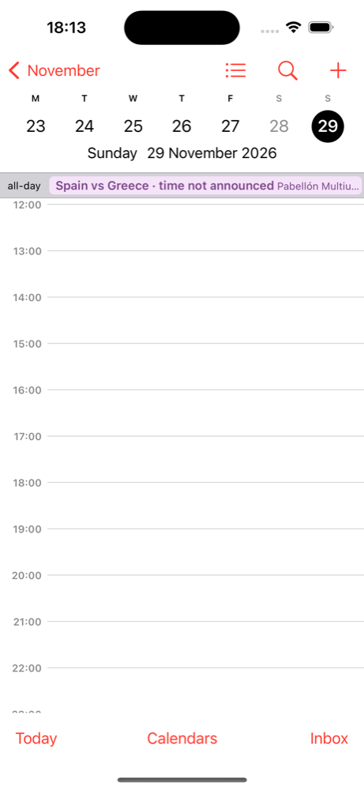
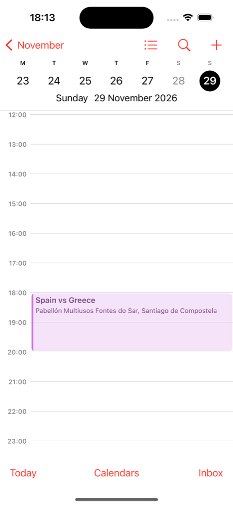
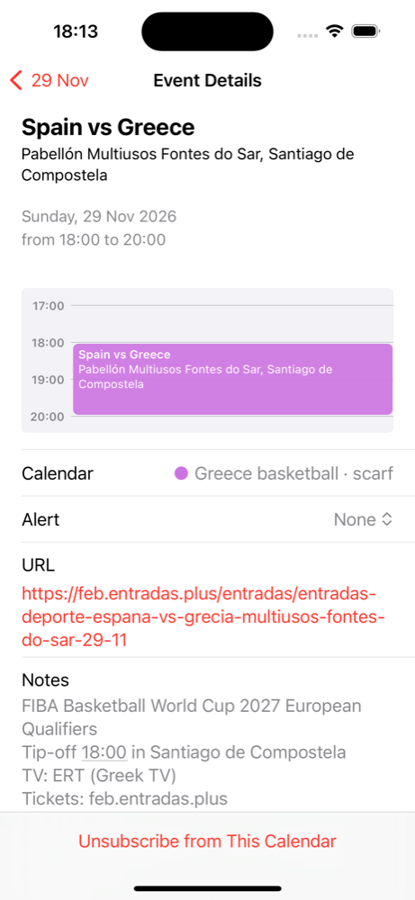
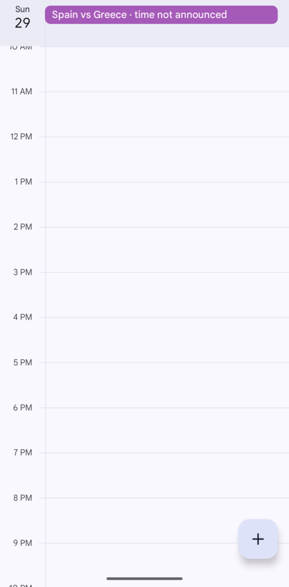
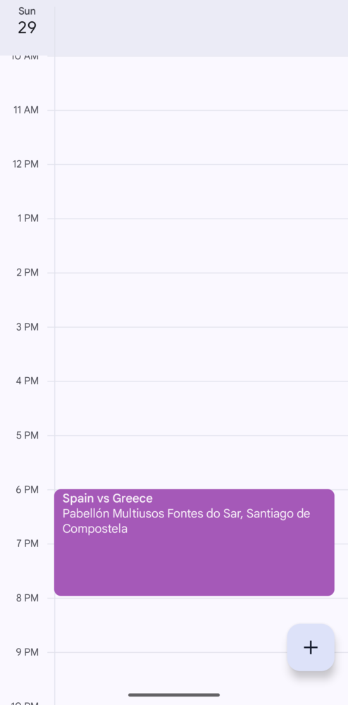
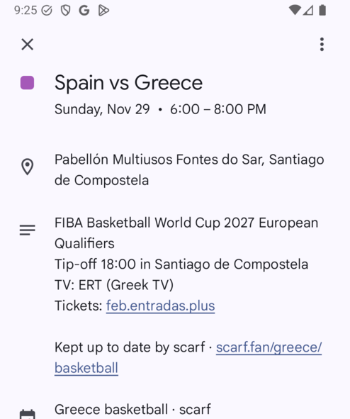

# Placeholder to timed game: what calendars do (#14)

A game with no announced time sits in the feed as an all-day placeholder,
`Spain vs Greece · time not announced`. Once the source gives a time, the next build writes the same
`UID` as a timed event. The question from [research-2026-10-02.md](research-2026-10-02.md): does each
calendar replace the placeholder cleanly, duplicate it, keep the all-day version, or ignore the change?

## How it was tested

Two versions of `/greece/basketball.ics`, both from the real generator (`toIcs` in `src/ics.ts`) and
`test/fixtures/fiba-games.html`, with no request to any source:

- **v1:** Spain vs Greece (`fiba-127107@scarf`, Sun 29 Nov 2026) with its `src/manual.ts` kickoff
  left out, so an all-day placeholder. Venue and ticket link already known.
- **v2:** the kickoff back in (17:00 UTC) and `DTSTAMP` a day later, as the next daily build writes it.

Nothing else differs. Greece vs Georgia stays an all-day placeholder in both, as a control. Both
versions carry `SEQUENCE:0`: ical-generator writes it on every event, and scarf never raises it.
Each client subscribes to v1, the file at the same URL is swapped for v2, and the client refreshes.
Apple read it from localhost. Google read it from a temporary secret gist, subscribed on the web, and
an Android 15 emulator signed in to the same account showed it in the Google Calendar app.

## Results

| Client | Result | Checked |
|---|---|---|
| Apple Calendar, iOS 17.5 (Simulator, "On My iPhone" subscription) | **Clean.** The all-day entry is gone; one timed game, 18:00–20:00 in the Simulator's Zürich time, with the new title, tip-off line, TV and tickets. | 2026-10-30, pull to refresh on the Calendars list |
| Apple Calendar, macOS | Not tested yet | |
| Google Calendar, account (what the web shows) | **Clean.** The same event (same Google event id) became timed, 17:00–19:00 UTC, with the new title and description. Still two events in the calendar. Google fetched v2 about 1.5 h after the swap. | 2026-10-31, read through the Google Calendar API; no web screenshot |
| Google Calendar, Android app (Android 15 emulator) | **Clean.** The all-day entry is gone; one timed game, 6–8 PM in Zürich time, with the new notes. It arrived about 22.5 h after the swap, with no manual refresh on an idle emulator. | 2026-11-01 |
| Outlook.com | Pending | |

The reminder shows "Alert: None" on iOS because iPhone doesn't schedule a feed's own reminders
(found 2026-10-30, PR #88). That is a separate question from this one.

## What it means for the feed

Apple and Google handle the switch with the stable `UID` alone, so the feed keeps `SEQUENCE:0` and a
build-time `DTSTAMP`. Google's phone app can trail the account by most of a day. If Outlook turns out to
duplicate or ignore the change, the fix is a `SEQUENCE` that rises with the game's data.
