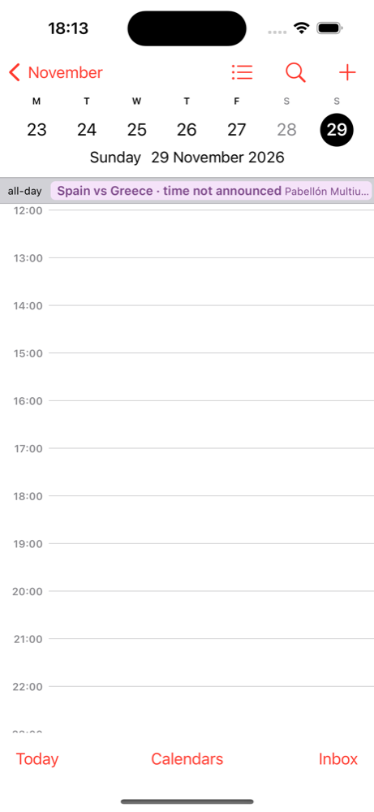
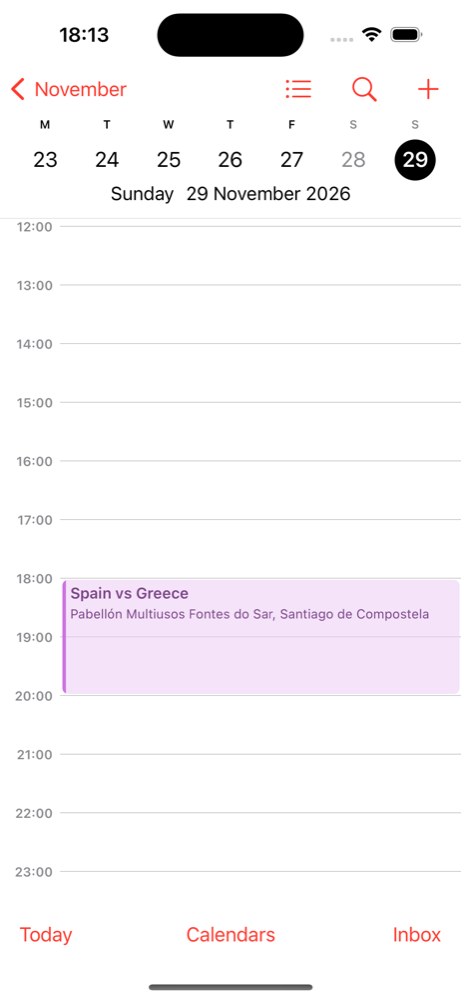
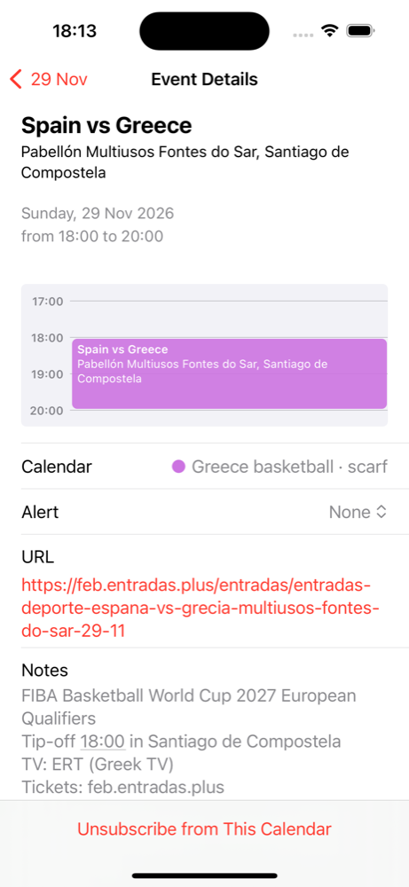

# Placeholder to timed game: what calendars do (#14)

A game with no announced time sits in the feed as an all-day placeholder,
`Spain vs Greece · time not announced`. Once the source gives a time, the next build writes the same
`UID` as a timed event. The question from [research-2026-10-02.md](research-2026-10-02.md): does each
calendar replace the placeholder cleanly, duplicate it, keep the all-day version, or ignore the change?

## How it was tested

Two versions of `/greece/basketball.ics`, both from the real generator (`toIcs` in `src/ics.ts`) and
`test/fixtures/fiba-games.html`, with no request to any source:

- **v1:** Spain vs Greece (`fiba-127107@scarf`, Sun 29 Nov 2026) with its `src/manual.ts` kickoff
  left out, so an all-day placeholder. Venue and ticket link already known.
- **v2:** the kickoff back in (17:00 UTC) and `DTSTAMP` a day later, as the next daily build writes it.

Nothing else differs. Greece vs Georgia stays an all-day placeholder in both, as a control. Both
versions carry `SEQUENCE:0`: ical-generator writes it on every event, and scarf never raises it.
Each client subscribes to v1, the file at the same URL is swapped for v2, and the client refreshes.

## Results

| Client | Result | Checked |
|---|---|---|
| Apple Calendar, iOS 17.5 (Simulator, "On My iPhone" subscription) | **Clean.** The all-day entry is gone; one timed game, 18:00–20:00 in the Simulator's Zürich time, with the new title, tip-off line, TV and tickets. | 2026-10-30, pull to refresh on the Calendars list |
| Apple Calendar, macOS | Not tested yet | |
| Google Calendar, web | Pending | |
| Google Calendar, Android | Pending | |
| Outlook.com | Pending | |

The reminder shows "Alert: None" on iOS because iPhone doesn't schedule a feed's own reminders
(found 2026-10-30, PR #88). That is a separate question from this one.

## What it means for the feed

Apple handles the switch with the stable `UID` alone, so the feed keeps `SEQUENCE:0` and a build-time
`DTSTAMP`. If Google or Outlook duplicates or ignores the change, the fix is a `SEQUENCE` that rises
with the game's data.
